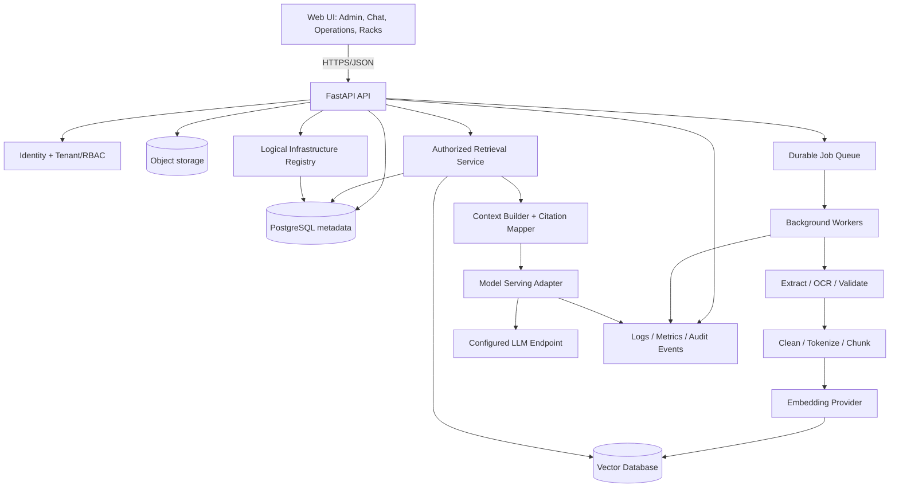

# Architecture — RackFlow AI

## 1. Architecture decision
Start as a **modular monolith plus asynchronous worker processes**, not as many microservices. Keep clear interfaces so components can be separated later when traffic, team size, or deployment needs justify it.

## 2. High-level view



## 3. Main modules
1. **Web application:** dashboard, document library, upload, chat, job details, users/roles, logical racks/resources.
2. **API layer:** validation, authentication, authorization, rate limits, request IDs, response schemas.
3. **Identity/tenant module:** organization boundary, users, roles, collection permissions.
4. **Document ingestion:** upload orchestration, metadata, object storage, deduplication, job creation.
5. **Processing workers:** file extraction, OCR, validation, cleaning, tokenization, chunking.
6. **Embedding service interface:** provider-neutral chunk-to-vector contract.
7. **Vector-store adapter:** upsert/search/delete vectors with tenant and document metadata filters.
8. **Retrieval service:** permission-aware search, optional hybrid search/reranking, thresholding.
9. **Context builder:** token budget, deduplication, source ordering, citation mapping.
10. **Model-serving adapter:** local or remote inference provider, timeouts, concurrency and metrics.
11. **Job manager:** queue states, retries, backoff, cancellation, idempotency.
12. **Operations/observability:** metrics, logs, worker health, queue depth, latency, failure views.
13. **Evaluation:** curated test questions, expected sources, retrieval and grounded-answer metrics.
14. **Infrastructure registry:** logical racks, nodes, resource capacity, workload placement and state provenance.
15. **Audit service:** access and admin event history.

## 4. End-to-end flows

### 4.1 Ingestion flow
1. Authenticate user; resolve tenant and permissions.
2. Validate request and file constraints; stream to object storage.
3. Compute content hash; detect duplicate within permitted scope.
4. Create document record and processing job in a transaction/outbox-safe pattern.
5. Queue worker job; UI polls or receives updates for job state.
6. Extract selectable text. For scanned/image-only pages, invoke configured OCR.
7. Validate extraction quality; mark low-quality extraction for review or configurable failure.
8. Clean conservatively, normalize whitespace, preserve code/tables as far as possible.
9. Token-count and chunk with overlap; attach tenant, collection, document, page, chunk, and pipeline version metadata.
10. Generate embeddings and upsert vectors idempotently.
11. Mark document/index version successful; publish metrics and audit event.

### 4.2 Query flow
1. Authenticate request and authorize collection.
2. Validate query length and apply rate limit.
3. Embed query using the same compatible embedding model/version as indexed chunks.
4. Search vector store with tenant and permission filters applied before results are returned.
5. Optional hybrid retrieval and reranking; deduplicate and threshold results.
6. Build bounded context with source IDs/page references.
7. Call model-serving adapter with system policy plus question and untrusted retrieved context clearly delimited.
8. Validate response structure and map citations only to actually retrieved authorized sources.
9. Return answer, citations, evidence/insufficiency signal, model metadata, and latency.
10. Store conversation and audit metadata according to retention policy; do not log full sensitive content by default.

### 4.3 Queue/worker failure flow
- Queue retains jobs until acknowledged under the selected queue semantics.
- Worker marks attempt and heartbeat; successful stage writes are idempotent.
- Transient failure → bounded exponential retry with jitter.
- Permanent/invalid input → failed state with safe error code and diagnostic correlation ID.
- Retry exhaustion → terminal failed state and operator-visible event.
- Worker loss → queue redelivery/lease expiry based on chosen broker; never assume this works until integration-tested.

### 4.4 Scale flow
- API replicas scale independently from worker replicas.
- Queue provides backpressure; worker replicas can scale based on queue depth and processing latency.
- Model replicas/serving endpoints scale separately based on inference concurrency, latency, memory, and accelerator availability.
- Vector DB and PostgreSQL scale using their own supported deployment strategies.
- A load balancer distributes traffic to healthy API/model-serving replicas; it does not replace queues or retries.

## 5. Data ownership
- PostgreSQL: tenants, users, roles, collections, document metadata, jobs, conversations, rack registry, audit metadata, evaluation runs.
- Object storage: original files and optional extracted-text artifacts under tenant-scoped keys.
- Vector DB: chunk embeddings plus minimal filterable metadata; never rely on vector-store filters as the only authorization check.
- Redis/queue broker: transient coordination and job transport; configure persistence/visibility semantics appropriately.
- Logs/metrics: operational data only; avoid raw documents, secrets, and full prompts by default.

## 6. Provider interfaces
Define interfaces for:
- `TextExtractor`
- `OCRProvider`
- `Tokenizer`
- `EmbeddingProvider`
- `VectorStore`
- `Reranker` (optional)
- `ChatModelProvider`
- `ObjectStorage`
- `JobQueue`
- `MetricsExporter`

A provider change must not require rewriting the whole application.

## 7. Model strategy
- Prototype with a small instruct model only after checking its language support, context window, license, hardware needs, and quality.
- `Qwen2.5-0.5B-Instruct` is a candidate for an experiment, not a production guarantee.
- Keep model endpoint configurable; use a provider adapter and model registry/config.
- For 500 concurrent engineers, capacity depends on request rate, prompt length, generation length, hardware, batching, and model-serving stack. Benchmark before claiming support.
- Use a dedicated serving runtime appropriate to the selected model/hardware. Do not assume one small model process can serve 500 concurrent requests acceptably.

## 8. Logical rack subsystem
- MVP represents logical racks, nodes/resources, workloads, capacity, labels, and health/provenance.
- Rack/node state sources: `manual`, `simulated`, or `integration`.
- Use a provider/integration boundary for future infrastructure connectors.
- No real hardware actions in MVP. Any future action API requires explicit authorization, approval workflow, audit trail, and safety checks.

## 9. Suggested repository layout

```text
rackflow-ai/
  apps/
    web/                         # Next.js UI
    api/                         # FastAPI app
    worker/                      # asynchronous job runner
  packages/
    contracts/                   # shared schemas/API types
    rag/                         # chunking, retrieval, context assembly
    providers/                   # model, embedding, OCR, vector, storage adapters
    observability/                # metrics/logging helpers
  infra/
    docker/
    compose/
    migrations/
  docs/
    PID.md
    PRD.md
    ARCHITECTURE.md
    DESIGN.md
    TODO.md
    PROGRESS.md
    API_SPEC.md
    DATA_MODEL.md
    SECURITY.md
    TESTING.md
    DEPLOYMENT.md
    DECISIONS.md
  scripts/
  .env.example
  docker-compose.yml
  README.md
```

## 10. Architecture quality gates
- Every API endpoint checks authentication and authorization.
- Every tenant-owned DB query is tenant-scoped.
- Retrieval filters permissions before model context construction.
- Every long-running operation is represented by a job with traceable state.
- Pipeline stages are idempotent or have documented recovery logic.
- Provider implementations are tested behind shared contract tests.
- Simulated rack telemetry is visibly labelled as simulated.
